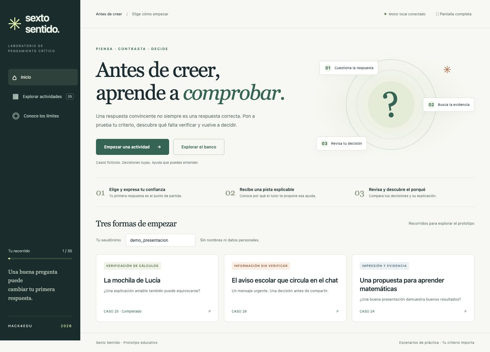

# Sexto Sentido: antes de creer

**Laboratorio de pensamiento crítico con IA · Hack4Edu 2026 · Primera versión funcional (`v0.1.0`).**

Una respuesta convincente puede estar equivocada. Sexto Sentido propone casos breves para practicar cómo comprobar una afirmación, identificar información insuficiente y revisar una decisión. Utiliza **IA simbólica (ASP/DLV)** para elegir ayudas pedagógicas con un motivo explícito.



## Para el jurado: empezar aquí

1. Descarga el repositorio con **Code → Download ZIP** y descomprímelo, o clónalo con Git.
2. Instala Python 3.9 o posterior y configura **DLV clásico** siguiendo [la guía de instalación](docs/INSTALACION.md). No se requieren paquetes Python de terceros. El ejecutable DLV es una dependencia externa y no está incluido.
3. Abre una terminal en la carpeta del repositorio y ejecuta:

```sh
python3 ejecutar.py --interfaz
```

En Windows usa `py -3 ejecutar.py --interfaz`. Abre **http://127.0.0.1:8765** en tu navegador y conserva la terminal abierta. Para cerrar, presiona **Ctrl+C**. Si el puerto está ocupado, añade `--port 8766` y abre la dirección que se indique.

El repositorio contiene el código de una aplicación local: visitar GitHub permite inspeccionarlo o descargarlo, pero no ejecuta el tutor en línea. Una vez configuradas las dependencias, la actividad no requiere Internet.

## Qué probar

Usa un seudónimo ficticio, por ejemplo `jurado_demo`.

| Recorrido | Pasos sugeridos | Qué permite observar |
| --- | --- | --- |
| Caso 25: La mochila de Lucía | Opción inicial 1, confianza 90; después de la pista, opción 2 | Una explicación amable puede contener un error de cálculo; ayuda para verificar las bases porcentuales. |
| Caso 29: Aviso escolar | Opción inicial 1, confianza 95; después, opción 3 | El tutor prioriza detenerse y verificar la información antes de difundirla. |
| Adaptación por antecedentes | Con el mismo seudónimo: caso 24, opción 1 y revisión 3; luego caso 26, opción inicial 2 | La ayuda remite a una actividad previa con el mismo objetivo formativo. |

Las respuestas sugeridas son entradas ficticias para recorrer las funciones del software; no representan observaciones de estudiantes. También puedes responder libremente. Si aciertas inicialmente, pasarás a la explicación; con baja confianza, el tutor puede pedir una justificación.

En cada caso puedes desplegar **«¿Cómo tomó esta decisión el tutor?»** para inspeccionar la acción y el motivo producidos por DLV. La interfaz dispone de pantalla completa para la presentación.

## Qué incluye esta versión

- **35 actividades:** 23 ejercicios de razonamiento y 12 casos sobre uso crítico y responsable de IA.
- Interfaz en navegador y versión de consola.
- Respuesta y confianza iniciales, ayudas, revisión y reflexión final.
- Registro local de las decisiones y sus revisiones.
- Intervenciones explicables a partir de opciones elegidas, confianza e historial.
- Pruebas de integración y demostraciones reproducibles.

## Cómo funciona

```text
Caso editorial → elección y confianza del estudiante
              → Python clasifica la opción usando la clave docente
              → ASP/DLV selecciona una acción y explica su motivo
              → pista / revisión → explicación y reflexión
```

Las claves de respuesta proceden de un banco editorial. DLV selecciona la intervención; no inventa las respuestas correctas. Las reflexiones se guardan para consulta humana y no se evalúan semánticamente de forma automática.

## Verificación técnica

```sh
python3 ejecutar.py --comprobar
python3 ejecutar.py --pruebas
python3 ejecutar.py --pruebas-interfaz
```

La suite original contiene **25 comprobaciones**. La suite de interfaz contiene **6 grupos**, con recorridos de acierto y error para las 35 actividades, segundos distractores, transferencia, prioridad de precaución, recuperación de sesión y manejo de fallos de DLV. Ambas utilizan historiales temporales. Consulta [el registro de validación](docs/VALIDACION.md).

Para listar las actividades o usar la consola:

```sh
python3 ejecutar.py --listar
python3 ejecutar.py --consola --alumno demo --problema 25 --una
```

`python3 ejecutar.py --demos` genera tres demostraciones con transcripciones y verifica sus acciones contra DLV. Crea una nueva carpeta local; sus archivos no forman parte del código fuente versionado.

## Alcance y límites

- Trabaja con escenarios preparados: no verifica noticias ni fuentes de Internet en tiempo real.
- No detecta técnicamente imágenes o audios manipulados.
- No diagnostica mecanismos mentales ni sustituye al docente o a profesionales.
- La ayuda considera antecedentes; la elección de la siguiente actividad es manual.
- La opción elegida se evalúa con una clave: el programa todavía no exige introducir cálculos propios ni registra una justificación antes de la primera pista.
- Las pruebas funcionales no demuestran mejora del aprendizaje ni cumplimiento formal de una rúbrica del concurso.

## Datos y privacidad de la demostración

Utiliza datos ficticios. La interfaz guarda respuestas, confianza, reflexiones y sesiones en `datos_interfaz/`, excluida de Git. La consola utiliza archivos de historial propios dentro del banco estable, también excluidos. Los archivos son locales y no están cifrados; esta versión no tiene autenticación y escucha únicamente en `127.0.0.1`.

## Organización

```text
ejecutar.py                            Lanzador de la entrega
interfaz/                              Ventana local y pruebas de integración
KB_SextoSentido_35_ESTABLE_20261104_104711/  Motor, reglas y banco original
docs/                                  Instalación y evidencia técnica
```

La carpeta del motor conserva sus archivos originales y su manifiesto SHA-256. Sus guías históricas describen el empaquetado previo; para ejecutar esta entrega sigue este README. El guion de diez minutos es material interno de producción y no establece la duración oficial de entrega del hackatón.

DLV es software de terceros y mantiene sus condiciones de licencia. Consulta [la documentación de DLVSystem](https://www.dlvsystem.it/dlvsite/dlv/). Esta publicación no incorpora el ejecutable ni asigna una nueva licencia al trabajo previo del equipo.
